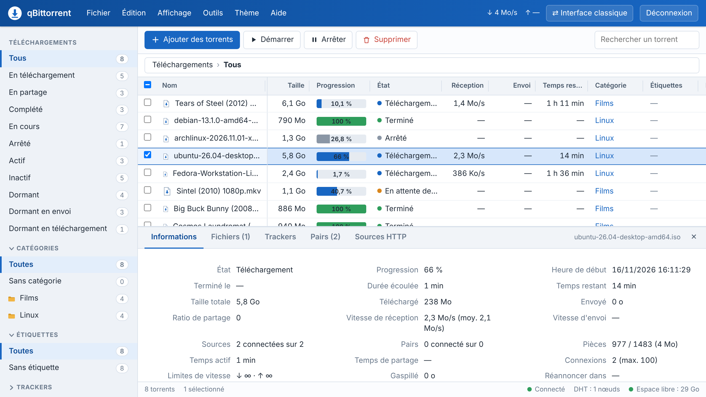
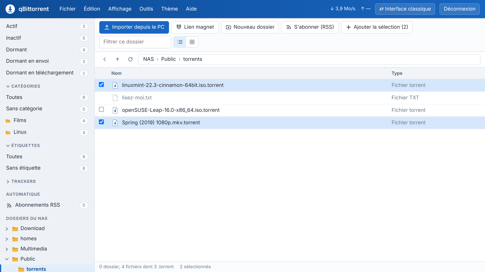
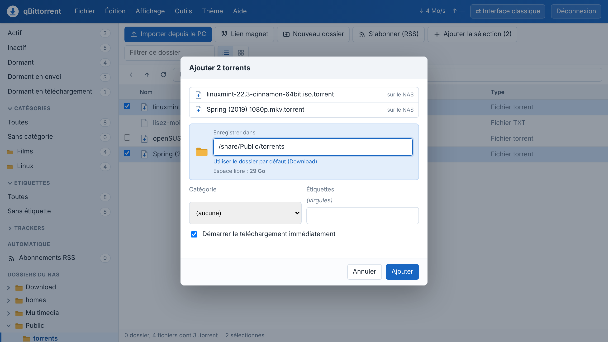
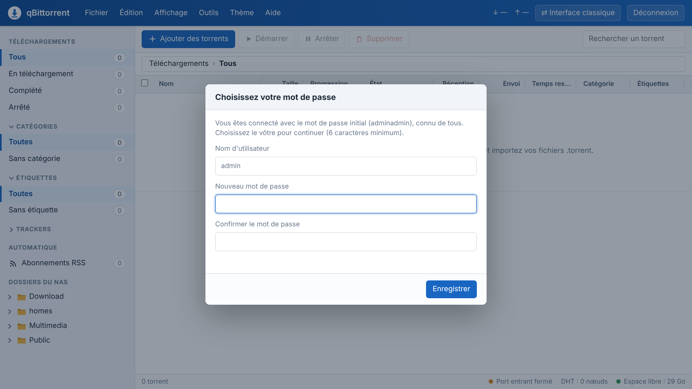
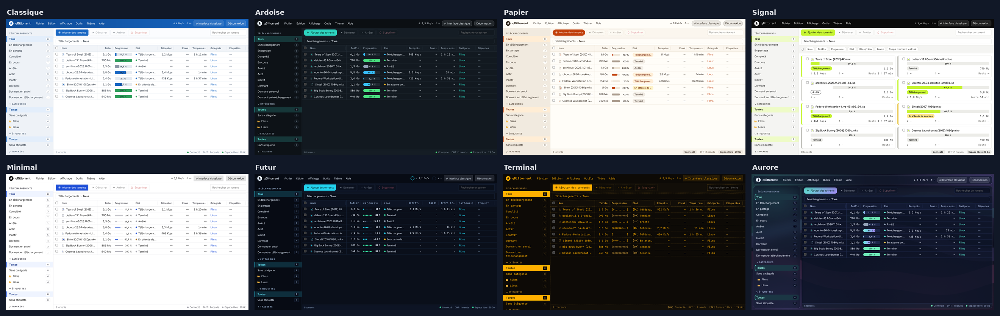

# qBittorrent for QNAP

**English** · [Français](README.fr.md)

A ready-to-install **QPKG** that adds [qBittorrent](https://www.qbittorrent.org/) to a QNAP NAS, with a web interface laid out like a file browser: open a shared folder, drop your torrents in, and they download there. Built as a replacement for Download Station. No Docker, no command line: everything happens in App Center and your browser.



[](https://github.com/Kill3rbee67/qbittorrent-qnap/actions/workflows/build.yml)
[](https://github.com/Kill3rbee67/qbittorrent-qnap/releases/latest)
[](https://github.com/Kill3rbee67/qbittorrent-qnap/releases)
[](LICENSE)

> **Language:** the explorer interface is in **French only** for now. The original qBittorrent Web UI, with all its translations, is bundled and one click away ("⇄ Interface classique"). Screenshots below show the French interface.

## Why this package

- **Pick the destination by browsing your NAS.** Navigate your shared folders, then add `.torrent` files from your computer (button or drag and drop), magnet links, or `.torrent` files already stored on the NAS. They download into the folder you are looking at.
- **See the free space before you start.** The add dialog shows the destination and its free space, and warns when there is not enough room.
- **Follow a series automatically.** Subscribe to an RSS feed from a folder: each new episode lands there, never twice.
- **Get notified.** E-mail when a download completes, or a webhook (Discord, Slack, Mattermost, ntfy, Home Assistant…) when a torrent is added or finished.
- **Reach it from outside without opening a port.** The interface is also served by QTS at `/qbittorrent/`, which works through myQNAPcloud Link.
- **Keep everything qBittorrent can do.** Menus, right-click actions, the details panel (files, trackers, peers), categories, tags, about 190 settings, speed limits, the log and the torrent creator are all there. The original Web UI stays available as a fallback.
- **Choose how it looks.** Eight themes, with the fonts shipped in the package: nothing is loaded from the Internet.
- **Update without losing anything.** Password, settings, torrents and RSS subscriptions survive updates, and every release is tested for exactly that before it is published.

Not included in the explorer interface: qBittorrent's search engine (it needs Python on the NAS and per-site plugins) and the speed graph.

| Browse a folder and tick the torrents to add | Check destination and free space |
|---|---|
|  |  |

## Compatibility

| | |
|---|---|
| CPU | **x86_64** (Intel / AMD). **ARM 64-bit** build available, experimental |
| Tested on | TS-453D (Celeron J4125). The ARM 64-bit build has not been tested on a real NAS yet |
| Minimum QTS | 4.5.0 |
| qBittorrent | 5.3.0, static binary from [userdocs/qbittorrent-nox-static](https://github.com/userdocs/qbittorrent-nox-static) |

Each release ships two packages: `…_x86_64.qpkg` and `…_arm_64.qpkg` (for example TS-233, TS-433, TS-x28A, TS-x32X). Older 32-bit ARM models are not supported. To find your CPU: Control Panel › System › System Information.

If you try the ARM build, please [tell us how it went](https://github.com/Kill3rbee67/qbittorrent-qnap/issues/new/choose), even a simple "it works" helps.

## Quick start

1. In **App Center**, open the settings (gear icon), *General* tab, and tick **"Allow installation of applications without a valid digital signature"**. The package is not signed by QNAP: only QNAP can sign packages that App Center recognises.
2. Download the package for your CPU from the [latest release](https://github.com/Kill3rbee67/qbittorrent-qnap/releases/latest): `qBittorrent_<version>_x86_64.qpkg` or `qBittorrent_<version>_arm_64.qpkg`.
3. In App Center, click **Install Manually** and choose the `.qpkg` file.
4. Open **`http://YOUR-NAS-IP:8085`** and sign in with `admin` / `adminadmin`.
5. Choose your own password when asked.

> ⚠️ **The initial password is public** (it is written right here). Until you change it, anyone on your network can sign in. Do it right after installing, and never expose port 8085 to the Internet.



### Alternative: add the app repository (in testing)

App Center then installs qBittorrent in one click and offers updates by itself.

1. App Center › settings › **App Repository** › **Add**.
2. Name: `qbittorrent-qnap`. URL: `https://raw.githubusercontent.com/Kill3rbee67/qbittorrent-qnap/main/repository.xml`
3. qBittorrent appears in that repository: click **Install**.

This method has not been verified on every model. If qBittorrent does not show up for your NAS, install manually and report your model in the [issues](https://github.com/Kill3rbee67/qbittorrent-qnap/issues).

## Themes



The **Thème** menu switches between **Classique** (default), **Ardoise** (dark), **Papier** (light, warm), **Signal** (high contrast, torrents as cards), **Minimal**, **Futur**, **Terminal** and **Aurore** (dark, frosted glass, animations). **Automatique** follows the light / dark setting of your device. The choice applies instantly and is remembered per browser. Every theme keeps text contrast at 4.5:1 or better, which the build checks.

## Everyday use

| | |
|---|---|
| Web interface | port **8085** (8080 belongs to QTS), HTTP or optional **HTTPS** with the NAS certificate; also `/qbittorrent/` on the QTS address |
| BitTorrent port | **51881**. Forward it to the NAS on your router for good speeds. If it is taken at startup, a nearby free port is chosen automatically |
| Default download folder | the QTS **Download** shared folder |
| Simultaneous downloads | 10 by default (15 active torrents in total), adjustable in the settings |
| Settings and torrents | the package's `profile/` folder: kept on update, deleted on uninstall |
| Log | `/share/CACHEDEV1_DATA/.qpkg/qBittorrent/qbittorrent.log` (the volume name may differ) |

**Remote access.** Sign in to your NAS on [myqnapcloud.com](https://www.myqnapcloud.com) and click the qBittorrent icon on the QTS desktop, or replace `/cgi-bin/…` with `/qbittorrent/` in the address bar. The trailing slash is required. Change the initial password first: the sign-in page becomes reachable from the Internet.

**With Plex, Jellyfin, Sonarr, Radarr.** Download straight into a library folder and let Plex or Jellyfin pick up new files. Tools running in Container Station can drive this qBittorrent through its API: host = NAS IP, port `8085`, same user and password.

**Updating.** With the app repository, click **Update** in App Center. Otherwise install the new `.qpkg` over the old one, without uninstalling. When an update changes the profile format, its [changelog](CHANGELOG.md) entry is marked "⚠ Migration" and explains what to do.

**Uninstalling.** App Center › qBittorrent › **Remove**. This deletes the package folder, including `profile/` (password, settings, torrent list, subscriptions). Your downloaded files are not touched.

The [French README](README.fr.md) goes further on each of these: RSS rules, notifications, remote access, backup and rollback.

## Troubleshooting

<details>
<summary><b>The interface does not respond (ERR_CONNECTION_REFUSED)</b></summary>

Check that the app is enabled in App Center, then look at the log over SSH:

```sh
/etc/init.d/qBittorrent.sh start
cat /share/CACHEDEV1_DATA/.qpkg/qBittorrent/qbittorrent.log
```

If you enabled HTTPS, the address is `https://NAS-IP:8085`, not `http://`.
</details>

<details>
<summary><b>Downloads stay stuck although the torrent has seeders</b></summary>

Open the torrent's **Trackers** tab. If no tracker has been contacted and the status bar shows **DHT: 0 nodes**, qBittorrent could not open its BitTorrent port, usually because Download Station already uses it. Restart qBittorrent from App Center: a free port is picked automatically.
</details>

<details>
<summary><b>qBittorrent no longer starts after a firmware update</b></summary>

A QTS update can untick "Allow installation of applications without a valid digital signature". Tick it again in App Center.
</details>

<details>
<summary><b>Lost password</b></summary>

Over SSH, as root. The initial password `adminadmin` applies again: change it at once.

```sh
/etc/init.d/qBittorrent.sh stop
sed -i '/^Password_PBKDF2=/d' /share/CACHEDEV1_DATA/.qpkg/qBittorrent/profile/qBittorrent/config/qBittorrent.conf
/etc/init.d/qBittorrent.sh start
```
</details>

<details>
<summary><b>Locked out after enabling HTTPS</b></summary>

Over SSH, as root:

```sh
/etc/init.d/qBittorrent.sh stop
sed -i 's/^HTTPS\\Enabled=true/HTTPS\\Enabled=false/' /share/CACHEDEV1_DATA/.qpkg/qBittorrent/profile/qBittorrent/config/qBittorrent.conf
/etc/init.d/qBittorrent.sh start
```
</details>

More cases, including myQNAPcloud Link errors, are covered in the [French README](README.fr.md#dépannage).

## Security

- **Public initial password.** `admin` / `adminadmin` is documented on purpose, so that installing needs no SSH. The forced change at first sign-in is a help, not a protection: whoever signs in first chooses the password.
- **Do not open port 8085 on your router.** For remote access use myQNAPcloud Link or a VPN (QVPN, WireGuard, Tailscale…). A VPN is the safest option.
- **The service runs as root**, like most QPKG packages. A flaw in qBittorrent or a weak interface password would give full access to the NAS. Hence the two points above.
- **Verified binary.** The qBittorrent binary comes from the userdocs project and its SHA-256 is checked at every build. Each release publishes a `PROVENANCE.txt` listing the versions and checksums of everything it embeds.

To report a vulnerability, see [SECURITY.md](SECURITY.md).

## Building from source

On Linux (Debian, Ubuntu…):

```sh
sudo apt install git curl rsync gcc qt6-l10n-tools
./build.sh                 # packages in build/, with PROVENANCE.txt
./build.sh --check         # only verify the checksums of upstream binaries
tests/upgrade-test.sh build/qBittorrent_<version>_x86_64.qpkg
```

The script downloads the qBittorrent binary (version and checksums pinned at the top of `build.sh`), the original Web UI of the same version, and QNAP's [QDK](https://github.com/qnap-dev/QDK). GitHub Actions runs the same steps on every pull request, and publishes a release only after the upgrade test passes.

## Contributing

Feedback on the ARM build and on the app repository is the most useful contribution right now. Bug reports, fixes and interface improvements are welcome too, in French or in English. See [CONTRIBUTING.md](CONTRIBUTING.md) (in French) for how to build, test the interface without a NAS, and open a pull request.

## License and credits

This project (scripts, explorer interface, tooling) is released under **GPL-2.0-or-later**: see [LICENSE](LICENSE). Published packages also bundle third-party components under their own licenses: qBittorrent and its original Web UI, the static build by [userdocs](https://github.com/userdocs/qbittorrent-nox-static), QNAP's QDK install script, and the theme fonts (SIL Open Font License 1.1). Details and sources: [docs/LICENCES.md](docs/LICENCES.md).

Community project, not affiliated with QNAP Systems, Inc. or with the qBittorrent project. QNAP, QTS and Download Station are trademarks of QNAP Systems, Inc.
