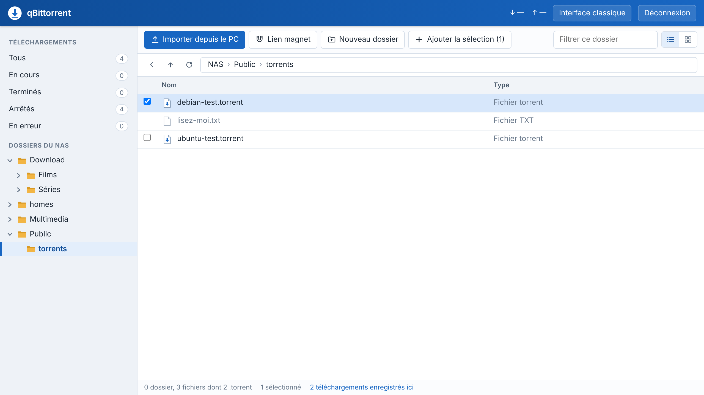
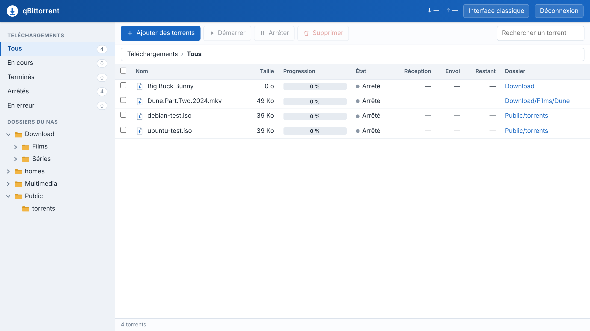
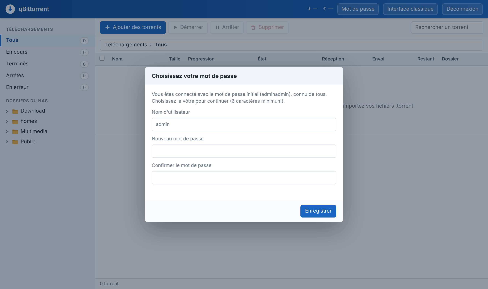

# qBittorrent pour QNAP

> **English** — A ready-to-install **QPKG** that adds qBittorrent 5.3 to QNAP NAS models (x86_64; ARM 64-bit build available, experimental), with a French web UI laid out like a file browser: browse your NAS shares and add `.torrent` files or magnet links straight into the folder you are viewing, subscribe to RSS feeds per folder, get e-mail or webhook notifications. Install from App Center (enable unsigned apps first, then either add the app repository `https://raw.githubusercontent.com/Kill3rbee67/qbittorrent-qnap/main/repository.xml` or install the `.qpkg` from the [releases](../../releases/latest) manually), open `http://NAS-IP:8085` (or `/qbittorrent/` on the QTS address, which also works remotely through myQNAPcloud Link) and log in with `admin` / `adminadmin` — **this default password is public: change it immediately** (you will be asked to) and never expose port 8085 to the Internet. Contributions welcome: see [CONTRIBUTING.md](CONTRIBUTING.md).

Paquet **QPKG** prêt à installer qui ajoute [qBittorrent](https://www.qbittorrent.org/) à un NAS QNAP, avec une interface web en français organisée comme un explorateur de fichiers. Pensé comme une alternative à Download Station : pas de Docker, pas de ligne de commande, tout se fait depuis l'App Center et le navigateur.



## Fonctionnalités

- **Navigation dans les dossiers partagés du NAS** (arborescence, fil d'Ariane, liste ou icônes) pour choisir où télécharger.
- **Ajout de torrents dans le dossier ouvert** :
  - fichiers `.torrent` depuis le PC (bouton ou glisser-déposer) ;
  - liens magnet ;
  - fichiers `.torrent` déjà présents sur le NAS (cocher ou double-cliquer).
- **Espace disque** : l'espace libre du dossier de destination et la taille des torrents sont affichés avant l'ajout, avec une alerte s'il n'y a pas assez de place ; l'espace libre reste visible dans la barre d'état.
- **Création de dossiers** à la volée : le dossier est créé au premier téléchargement.
- **Barre de menus et réglages** comme dans qBittorrent : Fichier, Édition (forcer la reprise, déplacer, revérifier, file d'attente…), Affichage (journal, statistiques), Outils (réglages, limites de vitesse alternatives), avec un clic droit sur les torrents. La fenêtre **Réglages** regroupe en français les réglages les plus utiles : téléchargements simultanés, vitesses et horaires, port, partage, RSS, notifications, HTTPS.
- **Abonnements RSS** : depuis le dossier d'une série, « S'abonner (RSS) » avec l'adresse d'une recherche, et chaque nouvel épisode publié est téléchargé automatiquement dans ce dossier.
- **Notifications** par e-mail (téléchargement terminé) ou par webhook (Discord, Slack, Mattermost, ntfy, Home Assistant…) à chaque nouveau torrent ou téléchargement terminé.
- **Suivi des téléchargements** : progression, vitesses, temps restant, détail par fichier, trackers et pairs, filtres (en cours, terminés, arrêtés, en erreur).
- **Accès à distance par myQNAPcloud Link** : l'interface est aussi servie par QTS à l'adresse `/qbittorrent/`, sans ouvrir de port sur la box.
- **HTTPS en option**, avec le certificat du NAS.
- L'**interface d'origine** de qBittorrent (en français) est incluse : bouton « ⇄ Interface classique » pour y aller, bouton « ⇄ Interface explorateur » pour revenir.



## Compatibilité

| | |
|---|---|
| Processeur | **x86_64** (Intel / AMD) ; **ARM 64 bits** en version expérimentale |
| Testé sur | TS-453D (Celeron J4125). La version ARM 64 bits n'a pas encore été testée sur un vrai NAS. |
| QTS minimum | 4.5.0 |
| qBittorrent | 5.3.0 (binaire statique [userdocs/qbittorrent-nox-static](https://github.com/userdocs/qbittorrent-nox-static)) |

Chaque version est publiée en deux paquets : `…_x86_64.qpkg` pour les processeurs Intel / AMD et `…_arm_64.qpkg` pour les processeurs ARM 64 bits (par exemple TS-233, TS-433, TS-x28A, TS-x32X). Les anciens modèles ARM 32 bits ne sont pas pris en charge. Si vous essayez la version ARM, un retour (réussite ou problème) dans les [issues](../../issues) est le bienvenu.

Pour connaître le processeur de votre NAS : Panneau de configuration › Système › Informations système.

## Installation

Dans les deux cas, commencez par ouvrir l'**App Center**, ses paramètres (roue dentée), onglet *Général*, et cochez **« Autoriser l'installation d'applications sans signature numérique valide »**. Le paquet n'est pas signé par QNAP : seul QNAP (ou le Qnapclub Store) peut signer des paquets reconnus par l'App Center.

### Méthode 1 : source d'applications (en test)

L'App Center installe alors qBittorrent en un clic et propose lui-même les mises à jour.

1. App Center › paramètres › onglet **Source d'applications** (*App Repository*) › **Ajouter**.
2. Nom : `qbittorrent-qnap` ; adresse : `https://raw.githubusercontent.com/Kill3rbee67/qbittorrent-qnap/main/repository.xml`
3. qBittorrent apparaît dans cette source : cliquez sur **Installer**.

Cette méthode n'a pas encore été vérifiée sur tous les modèles. Si qBittorrent n'apparaît pas pour votre NAS, utilisez la méthode 2 et signalez votre modèle dans les [issues](../../issues).

### Méthode 2 : installation manuelle

1. Téléchargez depuis la [dernière release](../../releases/latest) le fichier qui correspond à votre processeur : `qBittorrent_<version>_x86_64.qpkg` (Intel / AMD) ou `qBittorrent_<version>_arm_64.qpkg` (ARM 64 bits).
2. Dans l'App Center, cliquez sur **Installation manuelle** et choisissez le fichier `.qpkg`.

Ouvrez ensuite **`http://IP-DE-VOTRE-NAS:8085`**.

### Première connexion

| | |
|---|---|
| Utilisateur | **`admin`** |
| Mot de passe initial | **`adminadmin`** |

> ⚠️ **Ce mot de passe initial est public** (il figure ici, dans un dépôt public). Tant que vous ne l'avez pas changé, n'importe qui sur votre réseau peut se connecter à qBittorrent. L'interface vous impose d'en choisir un autre dès la première connexion : faites-le **juste après l'installation**, avant de rendre le NAS accessible à d'autres personnes, et n'ouvrez jamais le port 8085 sur Internet.



Vous pourrez ensuite le modifier à tout moment avec Outils › Mot de passe. La page de connexion rappelle ces consignes, et affiche une alerte renforcée si elle est ouverte depuis une adresse Internet.

## Mise à jour et migration

- **Avec la source d'applications** : cliquez sur **Mettre à jour** dans l'App Center.
- **Sinon** : installez la nouvelle version **par-dessus** l'ancienne (Installation manuelle), sans désinstaller.

Sont conservés : mot de passe, réglages, torrents en cours et terminés, abonnements RSS, notifications (tout est dans le dossier `profile/` du paquet, que l'installation ne touche pas). Chaque release est vérifiée automatiquement : la CI installe la version précédente, y crée un mot de passe, un torrent, un abonnement et un réglage, installe la nouvelle version par-dessus et contrôle que tout est conservé (`tests/upgrade-test.sh`).

**Si le format du profil change** (par exemple lors d'une nouvelle version majeure de qBittorrent, qui convertit lui-même sa configuration au premier démarrage), l'entrée correspondante du [CHANGELOG](CHANGELOG.md) est marquée **« ⚠ Migration »** et indique la marche à suivre. Une conversion de ce type ne se fait que dans un sens : avant une telle mise à jour, sauvegardez le profil (en SSH, en root) :

```sh
/etc/init.d/qBittorrent.sh stop
cp -a /share/CACHEDEV1_DATA/.qpkg/qBittorrent/profile /share/Public/qbittorrent-profile-sauvegarde
/etc/init.d/qBittorrent.sh start
```

Pour revenir en arrière : réinstallez l'ancienne version depuis les [releases](../../releases), arrêtez qBittorrent, remettez le dossier `profile` sauvegardé à sa place, puis redémarrez.

## Désinstallation

App Center › qBittorrent › **Supprimer**. La désinstallation arrête le service et **supprime tout le dossier du paquet**, y compris `profile/` : mot de passe, réglages, liste des torrents et abonnements RSS. Rien d'autre n'est à nettoyer.

Les **fichiers téléchargés** dans les dossiers partagés (Download, etc.) **ne sont pas supprimés**.

Pour réinstaller plus tard en gardant vos réglages, sauvegardez `profile/` avant de désinstaller (commande ci-dessus), puis remettez-le en place après la réinstallation.

## Accès à distance (myQNAPcloud Link)

L'interface est aussi servie par le serveur web de QTS, à l'adresse **`/qbittorrent/`** :

| Depuis | Adresse |
|---|---|
| Le réseau local | `http://IP-DU-NAS:8085` (accès direct) ou `http://IP-DU-NAS:8080/qbittorrent/` (via QTS ; `https://IP-DU-NAS/qbittorrent/` si HTTPS est activé dans QTS) |
| Internet, avec myQNAPcloud Link | connectez-vous à votre NAS sur [myqnapcloud.com](https://www.myqnapcloud.com) puis cliquez sur l'icône **qBittorrent** du bureau QTS, ou, dans la barre d'adresse, remplacez `/cgi-bin/…` par `/qbittorrent/` (ex. `https://a4.myqnapcloud.com/qbittorrent/`) |

L'adresse doit se terminer par une barre oblique : `/qbittorrent/`, pas `/qbittorrent`. Rien à ouvrir sur la box : myQNAPcloud Link relaie la connexion en HTTPS. Les mêmes identifiants que sur le réseau local sont demandés.

Avant d'activer l'accès à distance :
- **changez le mot de passe initial** `adminadmin` pour un mot de passe long et unique : la page devient accessible depuis Internet à toute personne qui connaît l'adresse de votre NAS ;
- ne cochez pas « Chiffrer l'accès direct par le port 8085 (HTTPS) » dans les réglages de qBittorrent : tant qu'il est actif, l'accès par `/qbittorrent/` ne fonctionne plus (le chiffrement est alors assuré par QTS et myQNAPcloud) ;
- l'option « Ignorer l'authentification pour les clients sur localhost » de l'interface classique est bloquée par le paquet : à travers QTS, toutes les connexions, y compris depuis Internet, arrivent de l'adresse locale du NAS.

Pour que cela fonctionne, le paquet déclare `/qbittorrent` auprès du proxy de QTS et règle qBittorrent en conséquence au démarrage : proxy local (127.0.0.1) déclaré de confiance, vérification de l'en-tête « Host » désactivée, authentification obligatoire pour les connexions locales.

## Télécharger automatiquement une série (RSS)

1. Sur votre site de torrents, faites la recherche qui correspond aux sorties voulues (par exemple `Ma Série 1080p`) et copiez l'adresse de son **flux RSS**. Sur certains sites, l'adresse de la page de résultats suffit : elle est convertie automatiquement.
2. Dans l'explorateur, ouvrez (ou créez) le dossier où ranger la série, puis cliquez sur **« S'abonner (RSS) »** et collez l'adresse.
3. Facultatif : affinez avec « Le titre doit contenir » / « ne doit pas contenir » (`720p|Batch`…).

Par défaut, seuls les **épisodes à venir** sont téléchargés (cochez « Télécharger aussi les épisodes déjà publiés » pour rattraper ceux du flux), et un même épisode n'est jamais téléchargé deux fois. La page **Abonnements RSS** permet de suspendre, modifier ou supprimer un abonnement, de forcer une vérification et de régler la fréquence de vérification des flux (30 minutes par défaut).

## Notifications

Outils › Réglages › **Notifications** :

- **E-mail** quand un téléchargement est terminé : adresse, serveur SMTP (par exemple `smtp.gmail.com`, chiffrement SSL/TLS ou STARTTLS) et identifiants. Fonction intégrée à qBittorrent.
- **Webhook** à chaque torrent ajouté (par exemple un nouvel épisode trouvé par un abonnement RSS) et/ou à chaque téléchargement terminé. Le message JSON envoyé est compris par Discord (`content`), Slack, Mattermost, Rocket.Chat (`text`) et les services génériques ; pour **ntfy**, un message texte simple est envoyé. Le journal des envois est dans `notify.log`, à côté de `qbittorrent.log`.

Le webhook utilise le « programme externe » de qBittorrent : s'il était déjà réglé pour autre chose dans l'interface classique, il est remplacé pour l'évènement choisi.

## Avec Plex, Jellyfin ou Container Station

- **Plex / Jellyfin** : faites télécharger directement dans le dossier d'une bibliothèque (abonnement RSS créé depuis ce dossier, ou dossier choisi à l'ajout). Activez dans Plex « Analyser ma bibliothèque automatiquement » (*Paramètres › Bibliothèque*), ou dans Jellyfin la surveillance en temps réel de la bibliothèque : les épisodes apparaissent dès la fin du téléchargement. Les fichiers sont créés par qBittorrent (root) et restent lisibles par Plex et Jellyfin.
- **Container Station** : des outils comme Sonarr, Radarr ou Prowlarr (en conteneurs) peuvent piloter ce qBittorrent par son API : client de téléchargement « qBittorrent », hôte = IP du NAS, port `8085`, utilisateur et mot de passe de l'interface. Si les conteneurs voient les dossiers sous d'autres chemins (`/downloads`…), déclarez la correspondance avec les chemins du NAS (`/share/Download`…) dans leurs réglages (*Remote Path Mappings*).
- **Docker plutôt que QPKG ?** Si vous préférez tout faire en conteneurs, l'image `linuxserver/qbittorrent` dans Container Station est une alternative ; ce projet vise au contraire une installation native, sans Docker.

## Bon à savoir

| | |
|---|---|
| Interface web | port **8085** (le 8080 est utilisé par QTS), en HTTP ou en **HTTPS** (Outils › Réglages › Interface) ; aussi `/qbittorrent/` sur l'adresse de QTS et par myQNAPcloud Link |
| Port BitTorrent | **51881** : pour de bons débits, redirigez-le vers le NAS sur votre box. Si ce port est déjà pris au démarrage, un port libre proche est choisi automatiquement (voir le journal). |
| Dossier de téléchargement par défaut | dossier partagé **Download** de QTS |
| Journal | `/share/CACHEDEV1_DATA/.qpkg/qBittorrent/qbittorrent.log` (le volume peut varier) |
| Téléchargements simultanés | 10 par défaut (15 torrents actifs au total, torrents lents non comptés), réglable dans Outils › Réglages › File d'attente |
| Réglages et torrents | dossier `profile/` du paquet, conservés lors des mises à jour, supprimés à la désinstallation |

**Interface d'origine de qBittorrent** : bouton « ⇄ Interface classique » (barre du haut), ou directement `http://IP-DU-NAS:8085/classic.html`. Pour revenir : bouton « ⇄ Interface explorateur » en haut à droite. Ne décochez pas « Utiliser l'interface Web alternative » dans les options : ce réglage fait fonctionner les deux interfaces.

## Dépannage

**L'interface ne répond pas (`ERR_CONNECTION_REFUSED`)**
Vérifiez que l'application est activée dans l'App Center, puis consultez le journal en SSH :
```sh
/etc/init.d/qBittorrent.sh start
cat /share/CACHEDEV1_DATA/.qpkg/qBittorrent/qbittorrent.log
```
Si vous avez activé HTTPS, l'adresse est `https://IP-DU-NAS:8085` (et non `http://`).

**Les téléchargements restent « En attente de sources » alors que le torrent a des seeders**
Ouvrez le torrent, onglet **Trackers**. Si tous les trackers restent « Pas encore contacté » et que la barre du bas indique **DHT : 0 nœuds**, qBittorrent n'arrive pas à ouvrir son port BitTorrent, généralement parce que **Download Station** l'utilise déjà (port 6881). Redémarrez qBittorrent depuis l'App Center : un port libre est choisi automatiquement. Vous pouvez aussi changer le port dans Outils › Réglages › Connexion. Si les trackers affichent une erreur, lisez la colonne « Message » : pare-feu (QuFirewall), VPN, proxy ou DNS.

**qBittorrent ne démarre plus après une mise à jour du firmware**
Une mise à jour de QTS peut désactiver l'option « Autoriser l'installation d'applications sans signature numérique valide ». Réactivez-la dans l'App Center.

**Mot de passe perdu**
En SSH, en root, supprimez la ligne du mot de passe puis redémarrez. Le mot de passe initial `adminadmin` sera de nouveau appliqué (à changer aussitôt) :
```sh
/etc/init.d/qBittorrent.sh stop
sed -i '/^Password_PBKDF2=/d' /share/CACHEDEV1_DATA/.qpkg/qBittorrent/profile/qBittorrent/config/qBittorrent.conf
/etc/init.d/qBittorrent.sh start
```

**myQNAPcloud Link : « Ce service ne prend pas en charge myQNAPcloud Link », ou page d'erreur sur `/qbittorrent/`**
Le message apparaît avec les versions antérieures à 5.3.3.0, et « Type de fichier inacceptable » avec la 5.3.3.0 : mettez à jour (5.3.3.1 ou plus). Vérifiez que l'adresse se termine bien par `/qbittorrent/`. Si `/qbittorrent/` affiche ensuite une erreur, vérifiez que l'accès direct `http://IP-DU-NAS:8085` fonctionne, que HTTPS n'est pas activé dans les réglages de qBittorrent, puis redémarrez qBittorrent depuis l'App Center. Si le problème persiste, ouvrez un ticket avec le résultat de ces commandes (en SSH, en root) :
```sh
getcfg qBittorrent Use_Proxy -f /etc/config/qpkg.conf; getcfg qBittorrent Proxy_Path -f /etc/config/qpkg.conf
cat /etc/app_proxy.conf
curl -sI http://127.0.0.1:8080/qbittorrent/ | head -n 1
```

**Plus d'accès après activation de HTTPS** (certificat refusé par le navigateur, par exemple)
En SSH, en root, désactivez HTTPS :
```sh
/etc/init.d/qBittorrent.sh stop
sed -i 's/^HTTPS\\Enabled=true/HTTPS\\Enabled=false/' /share/CACHEDEV1_DATA/.qpkg/qBittorrent/profile/qBittorrent/config/qBittorrent.conf
/etc/init.d/qBittorrent.sh start
```

## Sécurité

- **Mot de passe initial public.** `admin` / `adminadmin` est documenté ici à dessein, pour que l'installation reste simple sans SSH. Le changement imposé à la première connexion est une aide, pas une protection : si quelqu'un se connecte avant vous, il peut choisir le mot de passe à votre place. Installez, connectez-vous et changez le mot de passe dans la foulée.
- **Accès à distance.** N'ouvrez pas le port 8085 sur votre box (ni par la redirection automatique de ports de myQNAPcloud). Pour un accès à distance, utilisez myQNAPcloud Link (adresse `/qbittorrent/`, voir plus haut) ou un VPN (QVPN, WireGuard, Tailscale…). Avec myQNAPcloud Link, la page de connexion est joignable depuis Internet : seul le mot de passe protège alors l'accès, d'où l'importance d'un mot de passe long et unique (après plusieurs échecs, qBittorrent bloque temporairement l'adresse concernée). Le VPN reste l'option la plus sûre.
- **HTTPS en option** : Outils › Réglages › Interface › « Chiffrer l'interface web (HTTPS) ». Le paquet reprend à chaque démarrage le certificat du NAS (QTS › Sécurité › Certificat, Let's Encrypt compris) ; à défaut, il crée un certificat auto-signé, que le navigateur vous demandera d'accepter une fois. Sans HTTPS, le mot de passe circule en clair sur le réseau local.
- **Le service tourne en root**, comme la plupart des paquets QPKG. Concrètement, une faille dans qBittorrent ou dans son interface web, ou un mot de passe d'interface trop faible, donnerait un accès complet au NAS (tous les dossiers partagés, la configuration du système), et les fichiers téléchargés appartiennent à root. Faire tourner qBittorrent sous un utilisateur dédié demanderait de créer un compte système et de lui donner des droits sur les dossiers partagés, ce qui touche à la gestion des comptes de QTS et n'est pas proposé par ce paquet. D'où l'importance des points précédents : mot de passe fort, port 8085 jamais ouvert sur Internet.
- **Binaire vérifié** : le binaire qBittorrent provient du projet userdocs et son empreinte SHA-256 est vérifiée à chaque build, en CI comme en local ; chaque release publie un fichier `PROVENANCE.txt` (versions et empreintes de tout ce qui est embarqué).

## Construire le paquet, contribuer

Sous Linux (Debian, Ubuntu…) :

```sh
sudo apt install git curl rsync gcc qt6-l10n-tools
./build.sh                 # paquets dans build/, avec PROVENANCE.txt
./build.sh --check         # vérifie seulement les empreintes des binaires amont
tests/upgrade-test.sh build/qBittorrent_<version>_x86_64.qpkg [ancien.qpkg]
```

Le script télécharge le binaire qBittorrent (version et empreintes SHA-256 épinglées en tête de `build.sh`), l'interface web d'origine de la même version et l'outil [QDK](https://github.com/qnap-dev/QDK) de QNAP.

**Publier une nouvelle version** : augmentez `QPKG_VER` dans `src/qpkg.cfg`, complétez `CHANGELOG.md` et poussez sur `main`. GitHub Actions vérifie les empreintes, construit les paquets, **teste la mise à jour depuis la release précédente**, puis seulement crée le tag `v<version>`, publie la release et met à jour `repository.xml`. Chaque pull request passe par les mêmes étapes (sans publication).

**Nouvelles versions amont** : chaque lundi, un workflow compare les versions épinglées aux dernières versions de qbittorrent-nox (userdocs) et de QDK, et ouvre un ticket avec les lignes de `build.sh` à mettre à jour, empreintes comprises.

**Reproductibilité** : les entrées du build sont entièrement épinglées (versions et empreintes, voir `PROVENANCE.txt`). Les paquets eux-mêmes ne sont pas identiques au bit près d'un build à l'autre, car l'outil QDK de QNAP y inscrit la date de construction.

Voir [CONTRIBUTING.md](CONTRIBUTING.md) pour contribuer (retours sur la version ARM, traductions, corrections).

### Organisation du dépôt

```
src/qpkg.cfg                    description du paquet (nom, version, ports)
src/shared/qBittorrent.sh       script de démarrage et d'arrêt utilisé par QTS
src/shared/notify.sh            envoi des notifications web (webhook)
src/shared/webui/public/        page de connexion
src/shared/webui/private/       interface « explorateur de fichiers » (l'interface d'origine y est ajoutée au build, sous classic.html)
src/icons/                      icônes de l'App Center
src/package_routines            gabarit QDK (non modifié)
build.sh                        construction des paquets
tests/                          test de mise à jour et extraction d'un .qpkg
tools/make-repository.sh        génération de repository.xml (source d'applications)
repository.xml                  source d'applications de l'App Center (mise à jour par la CI)
assets/                         icônes affichées dans l'App Center
.github/workflows/              CI (build, tests, publication) et suivi des versions amont
```

## Licences

Ce projet (scripts, interface explorateur, outillage) est distribué sous licence **GPL-2.0-or-later** : voir [LICENSE](LICENSE). Les paquets publiés regroupent en plus des composants tiers sous leurs propres licences, toutes compatibles :

| Composant | Licence |
|---|---|
| qBittorrent (binaire `qbittorrent-nox`) | GPL-2.0-or-later, avec exception pour OpenSSL ; recette de compilation de userdocs : Apache-2.0 |
| libtorrent, Qt, OpenSSL, Boost, zlib (inclus dans le binaire statique de [userdocs](https://github.com/userdocs/qbittorrent-nox-static)) | BSD-3-Clause, LGPL-3.0, Apache-2.0, BSL-1.0, zlib |
| Interface web d'origine de qBittorrent (`classic.html` et ses fichiers) | GPL-2.0-or-later et MIT ; bibliothèques JavaScript incluses (MooTools, MochaUI…) : MIT |
| Script d'installation QDK de QNAP inclus dans chaque `.qpkg` | GPL-2.0-or-later (en-tête de `qinstall.sh`) |

Détails et sources correspondantes : [docs/LICENCES.md](docs/LICENCES.md).

Projet communautaire, sans lien avec QNAP Systems, Inc. ni avec le projet qBittorrent. QNAP, QTS et Download Station sont des marques de QNAP Systems, Inc.
